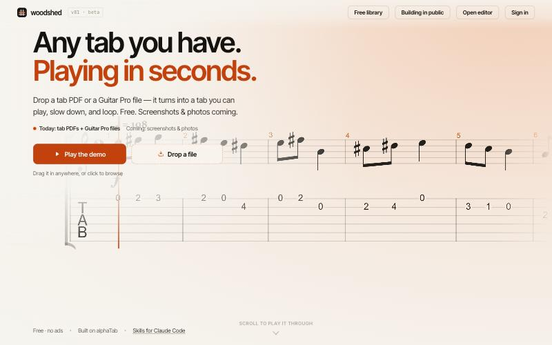
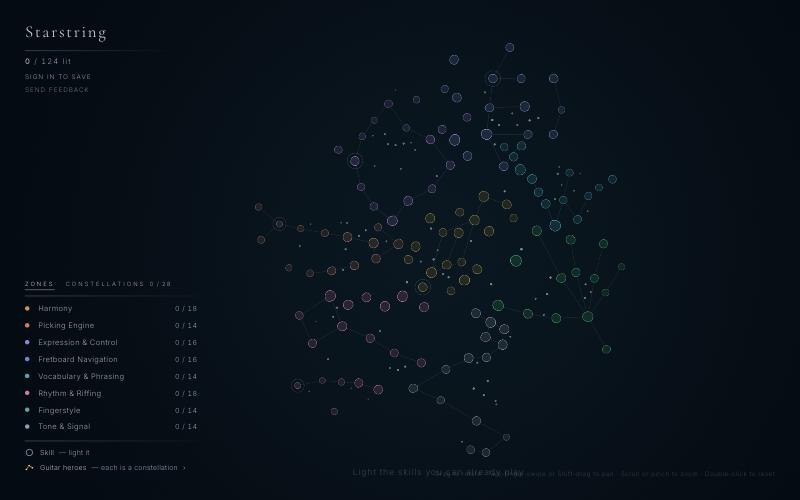

### Terry (Tianyi) Cao

Data infrastructure engineer, learning guitar from zero and building the tools
I wanted along the way. Every one of them checks itself against reality:
measured or verified, not guessed.

#### [woodshed — any tab you have, playing in seconds →](https://woodshed-web.fly.dev)

Drop a tab PDF or a Guitar Pro file and it turns into a tab you can play, slow
down and loop. Free, no ads.

#### [Starstring — a map of guitar skill →](https://starstring.fly.dev)

The guitar as a star map: 124 skills in 8 zones, with guitar heroes as
constellations. Light what you can already play and see what to practise next.

**More guitar tools**

- [**Tone Master Pro cheat sheet**](https://caoterry.github.io/tmp-atlas/) — what's inside all 255 factory presets of the Fender Tone Master Pro, which amp for which job, what the knobs really do; every model measured on the unit.
- [**scan-to-gp**](https://github.com/caoterry/scan-to-gp) — Claude Code skill: a scanned page of guitar music becomes a Guitar Pro file; two independent reads must agree on every note.
- [**scale-sequences**](https://github.com/caoterry/scale-sequences) — Claude Code skill: verified Guitar Pro practice files for scale sequences through any box and key.

**Data engineering**

- [**Reladomo #274**](https://github.com/goldmansachs/reladomo/pull/274) — added Snowflake support to Goldman Sachs' bitemporal Java ORM (merged).
- [**airflow-100k-partitions**](https://github.com/caoterry/airflow-100k-partitions) — can Apache Airflow 3 orchestrate 100k partitions? Benchmarked, with source reading.
- [**handover-chain**](https://github.com/caoterry/handover-chain) — durable per-project memory for Claude Code sessions, as plain Markdown.

Measure, don't guess.
